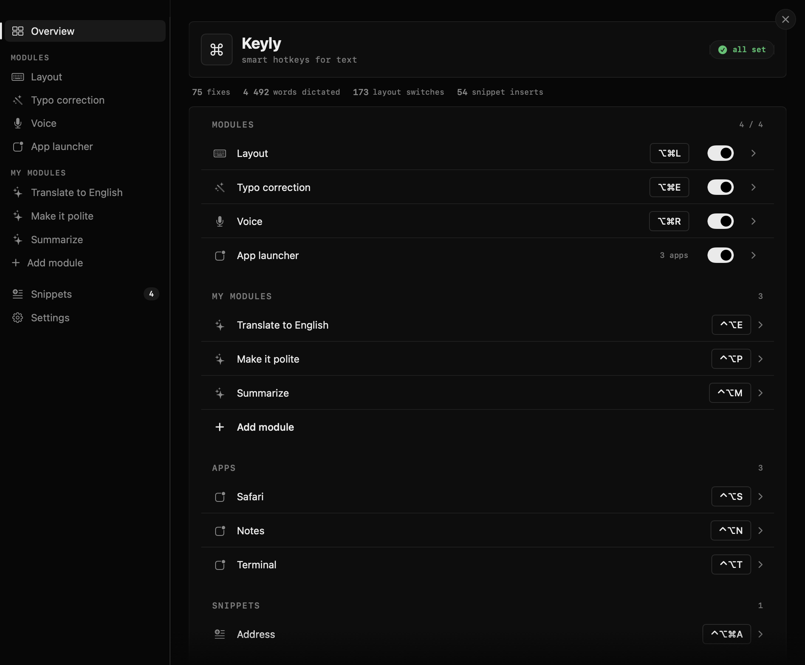
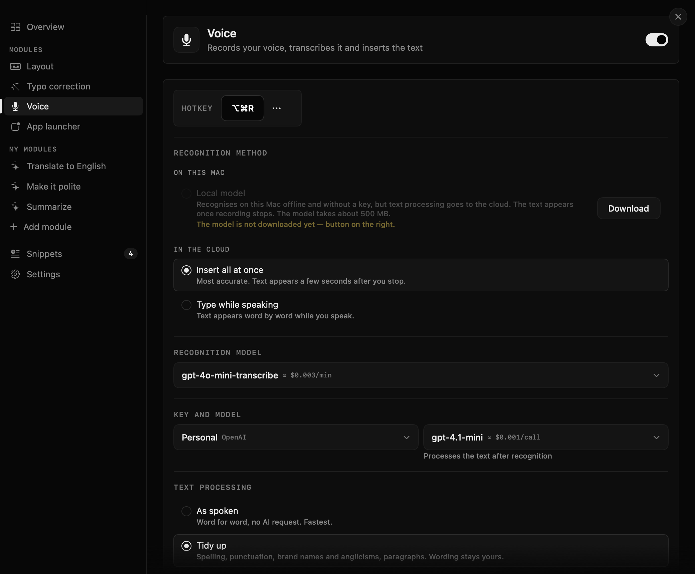
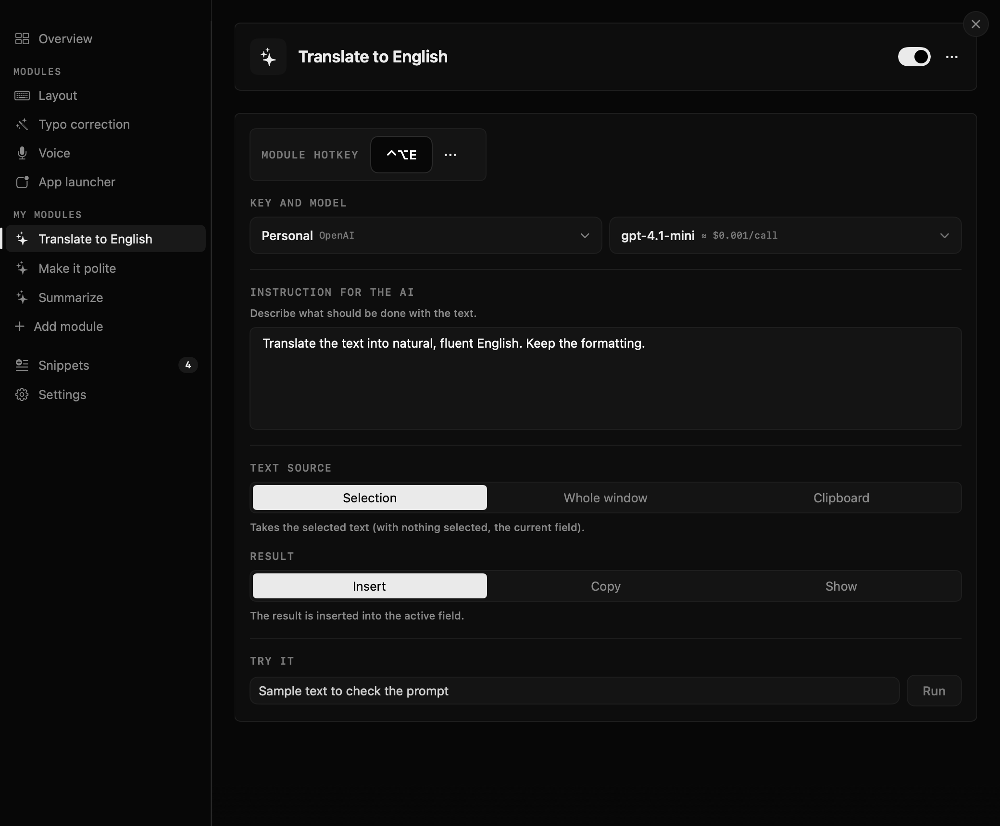
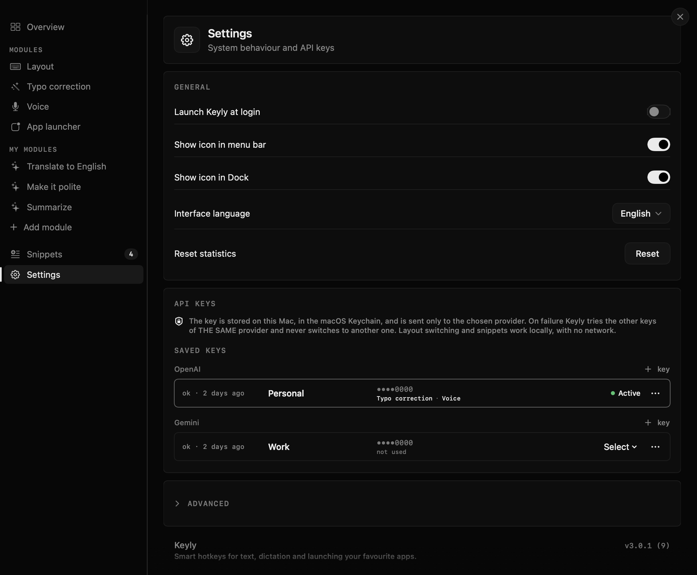

# Keyly

Smart hotkeys for text on macOS. Keyly lives in the menu bar and helps where you type:

- **Layout switch** — typed `ghbdtn` instead of `привет`? Press the hotkey and the word is retyped in the right layout (Russian ⇄ English).
- **Typo correction** — fixes spelling and punctuation in the selected text or the whole field via an LLM (OpenAI or Gemini, your own key).
- **Voice to text** — dictate anywhere: cloud recognition (OpenAI / Gemini) or a fully local on-device model. Optional cleanup of filler words and punctuation.
- **Custom AI modules** — your own instruction on a hotkey: translate, summarize, rewrite. Takes the selection or the clipboard, puts the result back where you want it.
- **Snippets** — text expansion by trigger or hotkey, with placeholders and a quick search palette.
- **App launcher** — open or switch to apps with one key.
- **Undo** — revert the last change Keyly made.

[Русская версия](README.ru.md)

<p align="center">
  
</p>

<p>
  
  
</p>
<p>
  
</p>

<p>
  
  
</p>

## Requirements

- macOS 15 or later, Apple silicon (arm64).
- Accessibility permission (hotkeys and text replacement), microphone permission for dictation.
- For AI features: your own OpenAI or Gemini API key. Layout switching, snippets, the app launcher and local dictation work without a key.

## Install

Download `Keyly.zip` from [Releases](../../releases), unzip and move `Keyly.app` to `/Applications`.

The app is not notarized by Apple, so macOS blocks the first launch. To allow it:

1. Open `Keyly.app` once — macOS shows a warning and refuses.
2. Open **System Settings → Privacy & Security**, scroll down and click **Open Anyway** next to the Keyly message.
3. Confirm with your password.

Or from Terminal:

```bash
xattr -dr com.apple.quarantine /Applications/Keyly.app
```

Then grant **Accessibility** in System Settings → Privacy & Security → Accessibility when Keyly asks.

## Privacy

Keyly has no server of its own. What leaves your Mac and where:

| Feature | What is sent | Where |
|---|---|---|
| Layout switch, snippets, app launcher, undo | nothing | stays on the Mac |
| Typo correction, custom modules | the text being processed | only to the provider of the key you selected (OpenAI or Gemini) |
| Dictation (cloud) | the audio of the recording; the recognized text, if text cleanup is on | only to the selected provider |
| Dictation (local model) | nothing — or the recognized text, if text cleanup is on | stays on the Mac / the selected provider |

- API keys are stored in the macOS Keychain and are never included in settings exports.
- Logs never contain the text you type or dictate, or your keys.
- Keyly does not insert into password fields.

## Build from source

```bash
git clone https://github.com/nagornik-icloud/keyly.git
cd keyly
./scripts/build-app.sh            # builds Release (arm64) into /Applications/Keyly.app
```

Requires Xcode 26 or later. The script builds for arm64 only: the FluidAudio dependency (local speech recognition) does not compile for Intel.

Code signing: without configuration the app is signed ad-hoc ("Sign to Run Locally"). To sign with your own Apple Development identity, create `Config/Local.xcconfig` (git-ignored):

```
DEVELOPMENT_TEAM = <your team id>
CODE_SIGN_IDENTITY = Apple Development
```

Ad-hoc builds change their signature on every rebuild, so macOS may ask again for Accessibility and Keychain access after an update.

Unit tests of the pure logic:

```bash
swift test
```

## License

[GPL-3.0](LICENSE)
