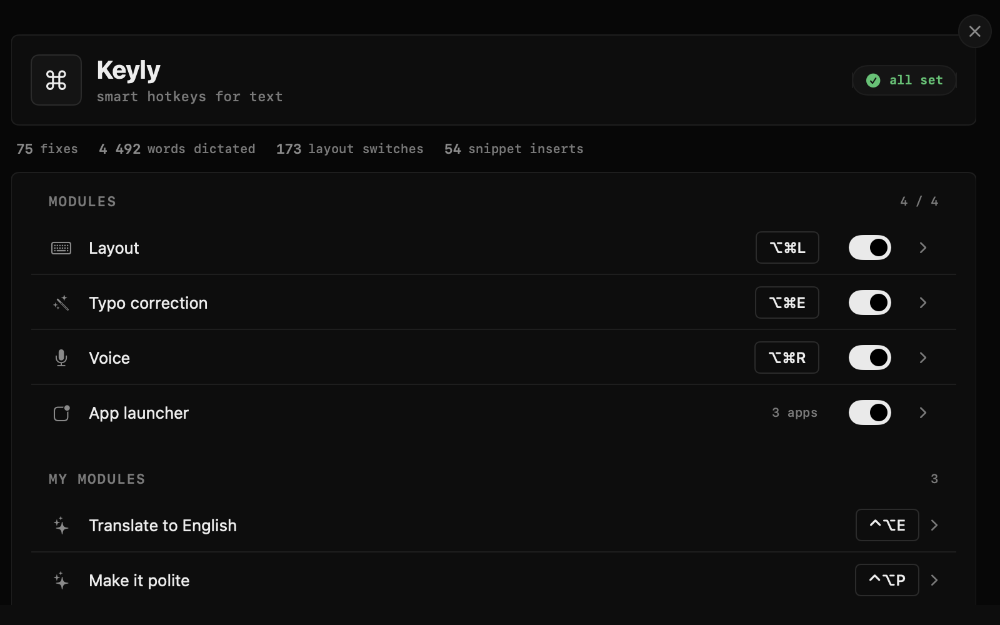
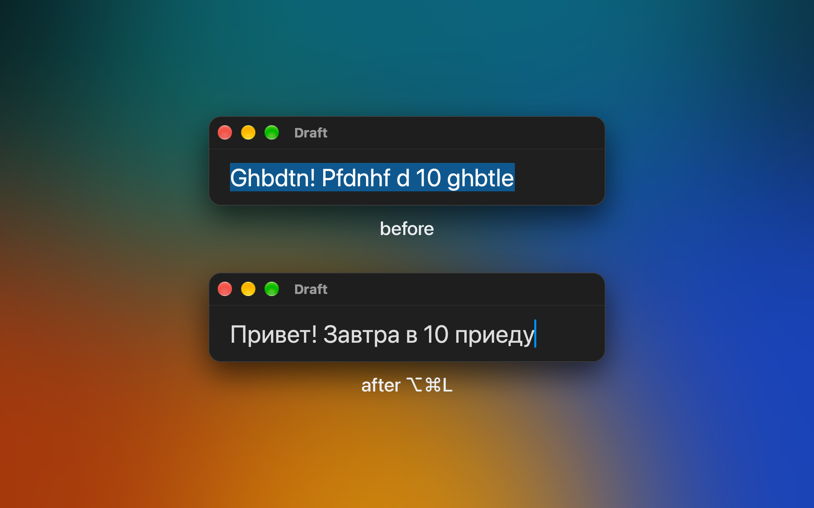
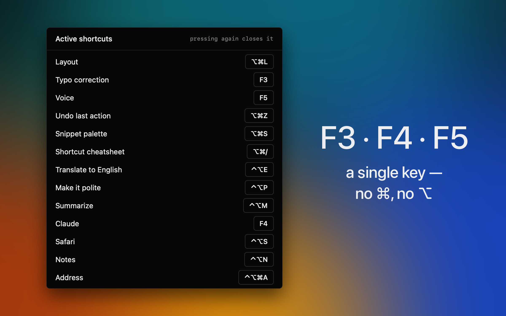
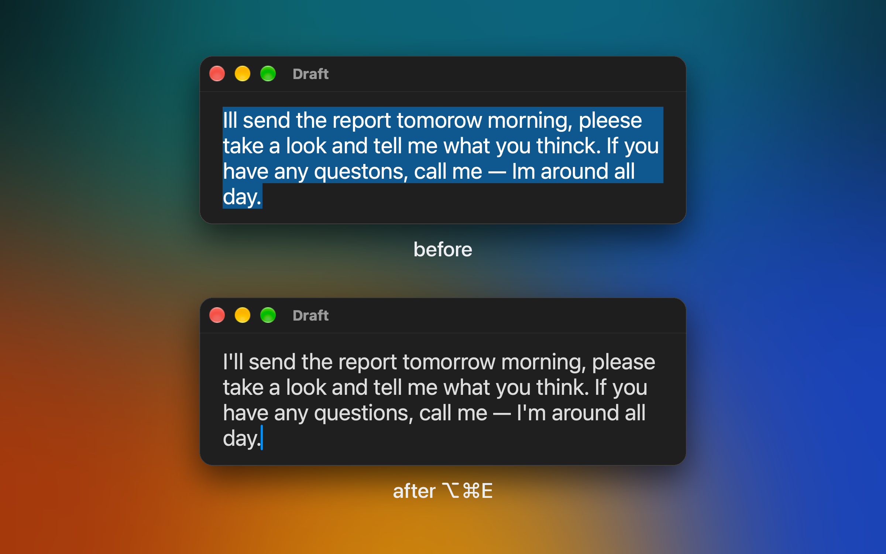
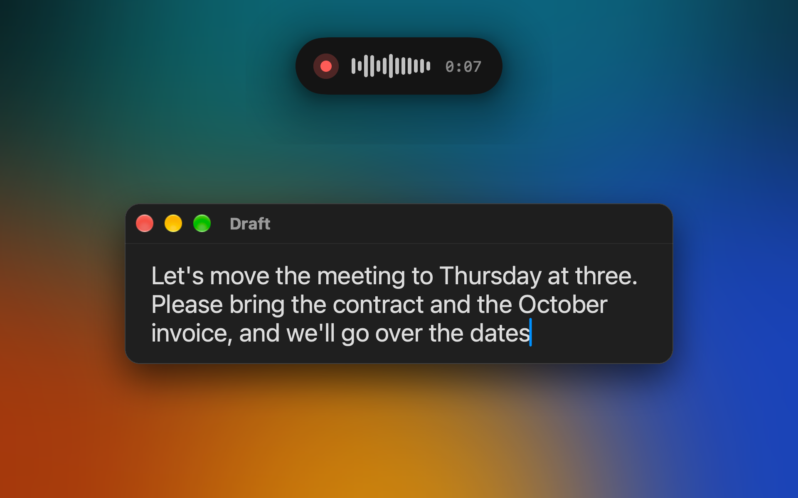
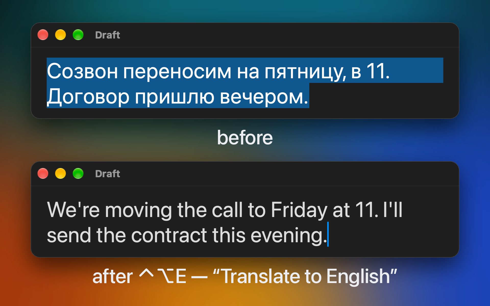
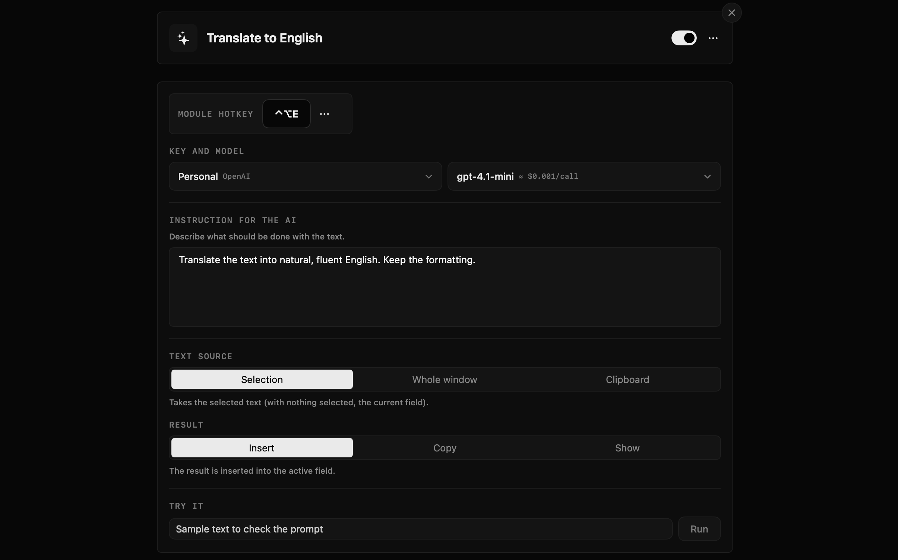

# Keyly

**Wrong layout, typos and voice to text — on a single key, even F4 or dictation.**

Text hotkeys for Mac, for people who type in Russian and English. Fixes text right where you type it. Product page with a live demo: **[nagornik.ru/en/p/keyly](https://nagornik.ru/en/p/keyly)** · [Русская версия](README.ru.md)

<p align="center">
  
</p>

## Download

**[Keyly.zip from the latest release](../../releases/latest)** — free, macOS 15 or newer, Apple Silicon. Unzip and move `Keyly.app` to `/Applications`.

The app is not notarized by Apple, so macOS blocks the first launch. To allow it:

1. Open `Keyly.app` once — macOS shows a warning and refuses.
2. Open **System Settings → Privacy & Security**, scroll down and click **Open Anyway** next to the Keyly message.
3. Confirm with your password.

Or from Terminal:

```bash
xattr -dr com.apple.quarantine /Applications/Keyly.app
```

Then grant the permissions Keyly asks for (see [Requirements](#requirements)). The first-run assistant walks you through them.

## What it does

### Wrong layout, fixed with one shortcut

Typed “Ghbdtn” instead of “Привет”? Press **⌥⌘L** — the word left of the cursor is retyped and the keyboard layout has already switched. Select a phrase and the whole phrase is retyped. No key, no internet.

<p align="center">
  
</p>

The direction comes from the letters of the text, not from the current layout.

### One key — even F4 or dictation

Unique: Keyly puts an action on a single key with no ⌘ or ⌥ — even keys macOS won't let you remap. F5 with the microphone starts voice, F4 with the magnifier opens Claude, F3 fixes typos. Brightness, sound, player keys and F1–F19 too.

<p align="center">
  
</p>

A bare key stops doing its macOS job while it is assigned — Keyly warns you when you set it. ⌘Q and ⌘Tab can never be taken.

### Typos fixed by a model

Select text, press **⌥⌘E**, and it is replaced with the corrected version right in the field. Three levels — spelling, plus punctuation, plus light style; if the model answers instead of editing, Keyly keeps your text.

<p align="center">
  
</p>

Needs your own OpenAI or Gemini key. The default level is spelling plus punctuation.

### Speak, and it's typed

Press **⌥⌘R** and speak, press again — the text lands where the cursor was. By default recognition runs on your Mac, no internet and no key; the cloud is more accurate and can type as you speak, with your own key.

<p align="center">
  
</p>

Esc cancels. The on-device model (about 500 MB) downloads once. Cloud: OpenAI or Gemini; typing while you speak works with OpenAI only.

### Your own AI command on a hotkey

Select a phrase, press **⌃⌥E** — and an English translation takes its place. You write the instruction yourself: “translate to English”, “make it polite”, “summary in three bullets”. It takes the selection, the whole window text or the clipboard; the result is inserted, copied or shown in a pop-up.

<p align="center">
  
</p>
<p align="center">
  
</p>

Each command has its own key and model, and a **Run** button to try it.

## Also

- **App launcher** — your own shortcut for an app, folder, file or link; press again to hide the app.
- **Snippets** — type `@@mail` in any app: the trigger is erased and the text is in its place; or put a snippet on a hotkey. Placeholders for date, time, clipboard and cursor position.
- **Snippet palette** ⌥⌘S — search by name, text and trigger, Enter inserts.
- **Undo** the last Keyly edit ⌥⌘Z — refuses if you have already changed the text.
- **Pause** from the menu bar — all hotkeys off at once, for example while you share your screen.
- **Cheat sheet** ⌥⌘/ — all your active shortcuts in a floating window.

Also good to know: leaves password fields alone and puts your clipboard back as it was; the Overview’s **Readiness** check tells you when a permission is missing; interface in English and Russian.

Where a key is needed and where it isn't:

- Layout switching, snippets, the palette, app launcher, undo, cheat sheet, pause — always on your Mac, no key.
- Voice on your Mac in “As spoken” mode (the default) — no internet, no key, free. “Tidy up” and “Tidy up and rewrite” send the recognised text to the cloud and need a key.
- Cloud voice — OpenAI or Gemini; “Type while speaking” works with OpenAI only.
- Typo correction and custom modules — always cloud, always your key.

## What it doesn't do

- Doesn't guess the layout as you type — it switches only on your key, so it never spoils a word you didn't ask about.
- No server, account or subscription of its own: AI features run on your OpenAI or Gemini key, and text goes only to that provider.
- Doesn't insert into password fields and doesn't keep what you type.
- Only the Russian ⇄ English layout pair.
- Only Macs with Apple Silicon and macOS 15 or newer.

## Requirements

- macOS 15 or later, Apple silicon (arm64).
- **Accessibility** — to read and replace text in other apps.
- **Input Monitoring** — to hear the hotkeys. Without it the menu bar icon shows up, but shortcuts stay silent.
- **Microphone** — for voice.
- For AI features: your own OpenAI or Gemini API key — created in your OpenAI or Google AI Studio account, paid to them per use (a short edit costs a fraction of a cent). Layout switching, snippets, the app launcher and on-device voice work without a key.

## Privacy

Keyly has no server of its own. What leaves your Mac and where:

| Feature | What is sent | Where |
|---|---|---|
| Layout switch, snippets, app launcher, undo | nothing | stays on the Mac |
| Typo correction, custom modules | the text being processed | only to the provider of the key you selected (OpenAI or Gemini) |
| Dictation (cloud) | the audio of the recording; the recognized text, if text cleanup is on | only to the selected provider |
| Dictation (local model) | nothing — or the recognized text, if text cleanup is on | stays on the Mac / the selected provider |

- API keys are stored in the macOS Keychain and are never included in settings exports.
- Logs never contain the text you type or dictate, or your keys.
- Keyly does not insert into password fields.

## Build from source

```bash
git clone https://github.com/nagornik-icloud/keyly.git
cd keyly
./scripts/build-app.sh            # builds Release (arm64) into /Applications/Keyly.app
```

Requires Xcode 26 or later. The script builds for arm64 only: the FluidAudio dependency (local speech recognition) does not compile for Intel.

Code signing: without configuration the app is signed ad-hoc ("Sign to Run Locally"). To sign with your own Apple Development identity, create `Config/Local.xcconfig` (git-ignored):

```
DEVELOPMENT_TEAM = <your team id>
CODE_SIGN_IDENTITY = Apple Development
```

Ad-hoc builds change their signature on every rebuild, so macOS may ask again for Accessibility and Keychain access after an update.

Unit tests of the pure logic:

```bash
swift test
```

## License

[GPL-3.0](LICENSE)
