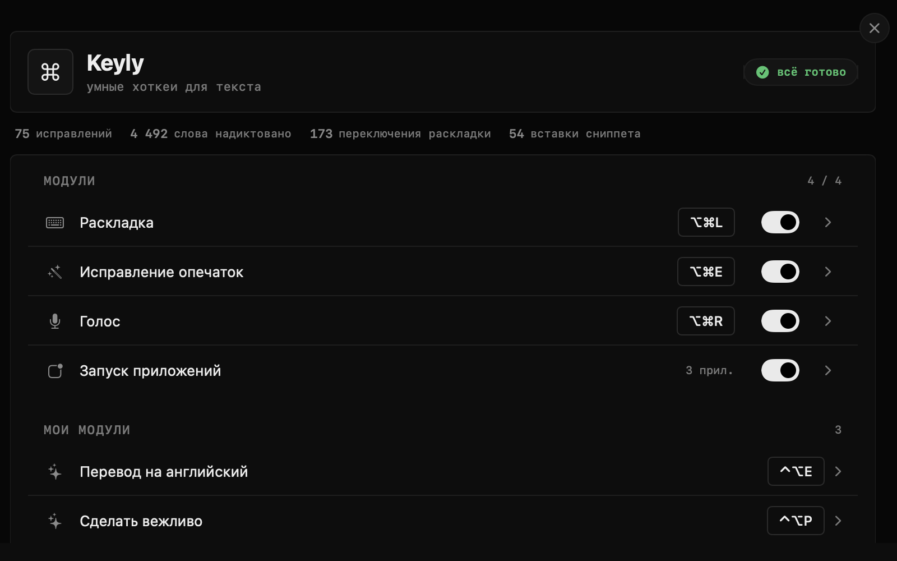
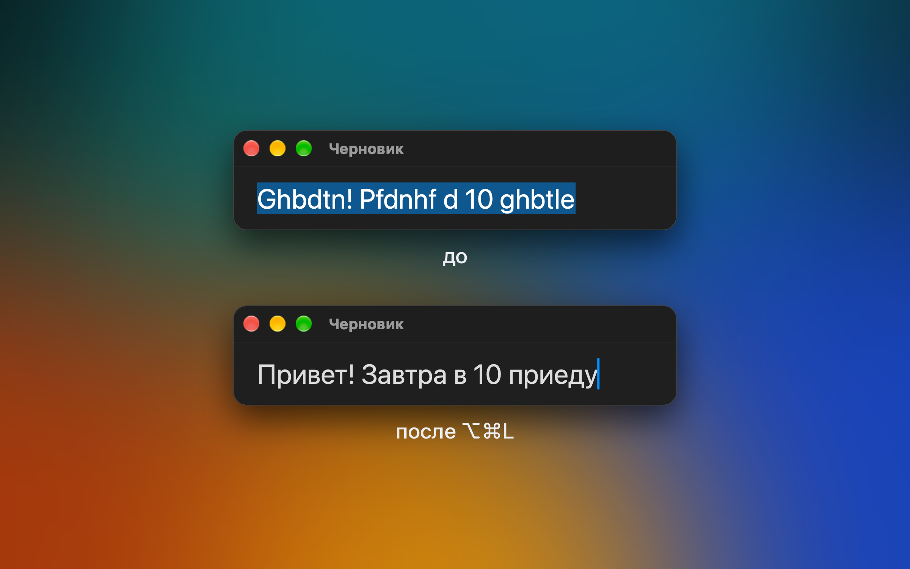
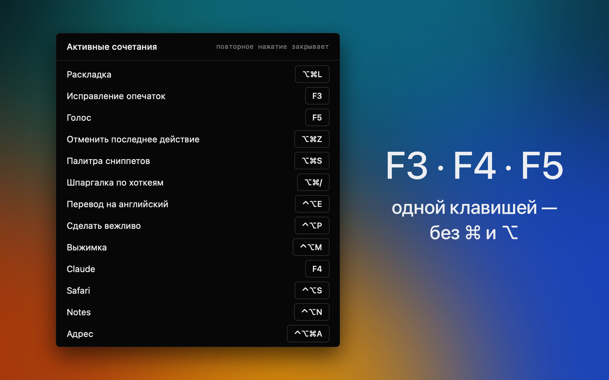
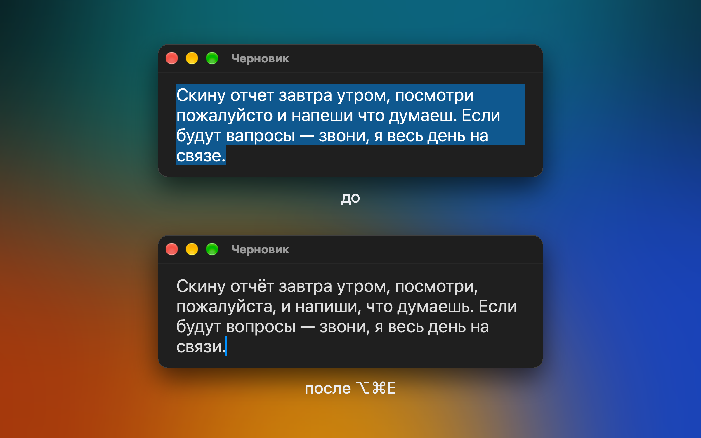
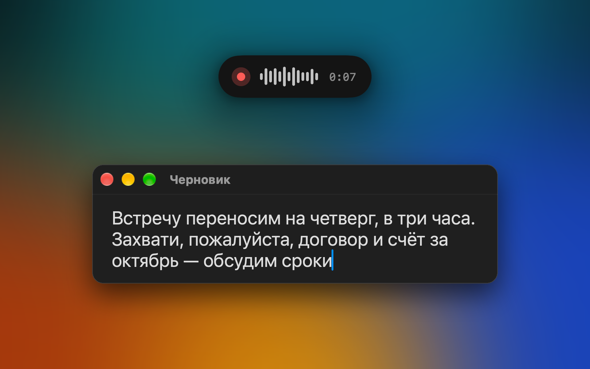
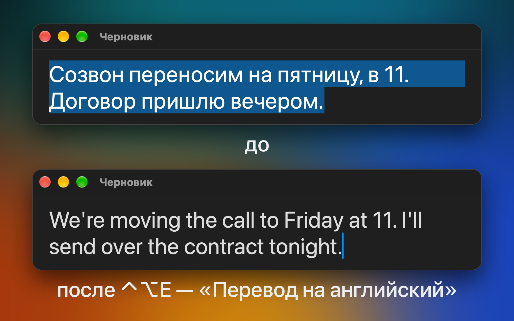
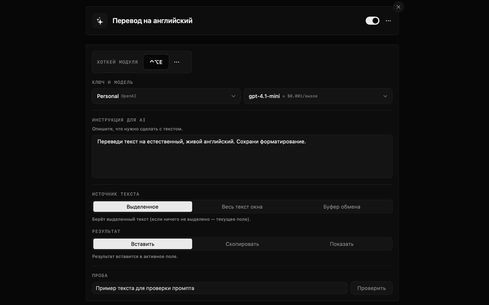

# Keyly

**Раскладка, опечатки и голос в текст — на одну клавишу, даже F4 или диктовку.**

Хоткеи для текста на Mac для тех, кто пишет по-русски и по-английски. Чинит текст там, где вы пишете. Страница с живой пробой: **[nagornik.ru/p/keyly](https://nagornik.ru/p/keyly)** · [English version](README.md)

<p align="center">
  
</p>

## Скачать

**[Keyly.zip из последнего выпуска](../../releases/latest)** — бесплатно, macOS 15 и новее, Apple Silicon. Распакуйте и перенесите `Keyly.app` в «Программы».

Приложение не нотаризовано Apple, поэтому macOS блокирует первый запуск. Чтобы разрешить:

1. Откройте `Keyly.app` один раз — macOS покажет предупреждение и не запустит.
2. Откройте **Системные настройки → Конфиденциальность и безопасность**, пролистайте вниз и нажмите **«Всё равно открыть»** рядом с сообщением о Keyly.
3. Подтвердите паролем.

Или в Терминале:

```bash
xattr -dr com.apple.quarantine /Applications/Keyly.app
```

Затем выдайте доступы, которые попросит Keyly (см. [Требования](#требования)). Мастер первого запуска проведёт по ним.

## Что умеет

### Неверная раскладка — одним сочетанием

Набрали «Ghbdtn» вместо «Привет»? **⌥⌘L** — слово слева от курсора перепечатано, а раскладка уже переключилась сама. Выделите фразу — перепечатается вся. Без ключа и без сети.

<p align="center">
  
</p>

Направление берётся из букв самого текста, а не из текущей раскладки.

### Одна клавиша — даже F4 или диктовка

Уникально: Keyly вешает действие на одну клавишу без ⌘ и ⌥ — даже на те, что macOS переназначать не даёт. F5 с микрофоном включает голос, F4 с лупой открывает Claude, F3 исправляет опечатки. Так же — яркость, звук, плеер и F1–F19.

<p align="center">
  
</p>

Пока клавиша занята, своё действие в macOS она не выполняет — Keyly предупредит при назначении. ⌘Q и ⌘Tab не перехватываются никогда.

### Опечатки исправит модель

Выделили текст — **⌥⌘E**, и он заменён исправленным прямо в поле. Три уровня — орфография, плюс пунктуация, плюс лёгкий стиль; если модель ответит вместо правки, Keyly оставит ваш текст.

<p align="center">
  
</p>

Нужен свой ключ OpenAI или Gemini. По умолчанию — орфография и пунктуация.

### Говорите — текст в поле

**⌥⌘R** — говорите, ещё раз — текст там, где стоял курсор. По умолчанию распознаёт прямо на Mac, без сети и ключа; облако точнее и умеет печатать на лету — по вашему ключу.

<p align="center">
  
</p>

Esc отменяет. Модель для Mac (около 500 МБ) докачивается один раз. Облако — OpenAI или Gemini; печать на лету — только с OpenAI.

### Своя команда на хоткей

Выделили фразу, нажали **⌃⌥E** — и на её месте перевод на английский. Инструкцию пишете сами: «переведи на английский», «сделай вежливо», «выжимка в три пункта». Берёт выделение, весь текст окна или буфер; результат вставит, скопирует или покажет в окошке.

<p align="center">
  
</p>
<p align="center">
  
</p>

У каждой команды свой ключ и модель и кнопка **«Проверить»**.

## Ещё умеет

- **Запуск приложений** — своё сочетание на программу, папку, файл или ссылку; повторное нажатие прячет программу.
- **Сниппеты** — набрали `@@mail` в любой программе: триггер стёрся, на его месте текст; или сниппет на хоткее. Подстановки даты, времени, буфера и места курсора.
- **Палитра сниппетов** ⌥⌘S — поиск по имени, тексту и триггеру, Enter вставляет.
- **Отмена** последней правки Keyly ⌥⌘Z — откажется, если вы уже поменяли текст.
- **Пауза** из строки меню — все хоткеи разом, например на время показа экрана.
- **Шпаргалка** ⌥⌘/ — все активные сочетания в плавающем окне.

Полезно знать: поля паролей не трогает и возвращает буфер обмена как было; «Готовность» в Обзоре скажет, если не выдан доступ; интерфейс на русском и английском.

Где нужен ключ, а где нет:

- Раскладка, сниппеты, палитра, запуск приложений, отмена, шпаргалка, пауза — всегда на Mac, ключ не нужен.
- Голос на Mac в режиме «Как сказал» (так по умолчанию) — без сети, без ключа, бесплатно. «Причесать» и «Причесать и переписать» отправляют распознанный текст в облако — нужен ключ.
- Голос в облаке — OpenAI или Gemini; «Печатать на лету» умеет только OpenAI.
- Исправление опечаток и свои модули — всегда облако и всегда ваш ключ.

## Чего не делает

- Не угадывает раскладку на лету — меняет только по вашей клавише, поэтому не испортит слово, которое вы не просили.
- Без своего сервера, аккаунта и подписки: AI-функции работают по вашему ключу OpenAI или Gemini, текст уходит только этому провайдеру.
- Не вставляет в поля паролей и не хранит набранный текст.
- Только пара русская ⇄ английская раскладка.
- Только Mac на Apple Silicon с macOS 15 и новее.

## Требования

- macOS 15 или новее, Apple silicon (arm64).
- **Универсальный доступ** — чтобы читать и заменять текст в других программах.
- **Мониторинг ввода** — чтобы слышать хоткеи. Без него значок в строке меню появится, а сочетания будут молчать.
- **Микрофон** — для голоса.
- Для AI-функций — свой ключ OpenAI или Gemini. Раскладка, сниппеты, запуск приложений и голос на Mac работают без ключа.

## Приватность

Своего сервера у Keyly нет. Что уходит с Mac и куда:

| Функция | Что отправляется | Куда |
|---|---|---|
| Раскладка, сниппеты, запуск приложений, отмена | ничего | остаётся на Mac |
| Исправление опечаток, свои модули | обрабатываемый текст | только провайдеру выбранного ключа (OpenAI или Gemini) |
| Диктовка (облако) | звук записи; распознанный текст, если включена обработка текста | только выбранному провайдеру |
| Диктовка (локальная модель) | ничего — или распознанный текст, если включена обработка текста | остаётся на Mac / выбранному провайдеру |

- API-ключи хранятся в связке ключей macOS и не попадают в экспорт настроек.
- В журналах нет набранного или надиктованного текста и ключей.
- В поля пароля Keyly ничего не вставляет.

## Сборка из исходников

```bash
git clone https://github.com/nagornik-icloud/keyly.git
cd keyly
./scripts/build-app.sh            # собирает Release (arm64) в /Applications/Keyly.app
```

Нужен Xcode 26 или новее. Скрипт собирает только под arm64: зависимость FluidAudio (локальное распознавание речи) не компилируется под Intel.

Подпись: без настройки приложение подписывается ad-hoc («Sign to Run Locally»). Чтобы подписать своим сертификатом Apple Development, создайте `Config/Local.xcconfig` (он в .gitignore):

```
DEVELOPMENT_TEAM = <ваш team id>
CODE_SIGN_IDENTITY = Apple Development
```

У ad-hoc сборок подпись меняется при каждой пересборке, поэтому после обновления macOS может снова спросить доступ к универсальному доступу и связке ключей.

Юнит-тесты чистой логики:

```bash
swift test
```

## Лицензия

[GPL-3.0](LICENSE)
